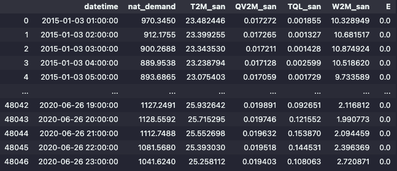
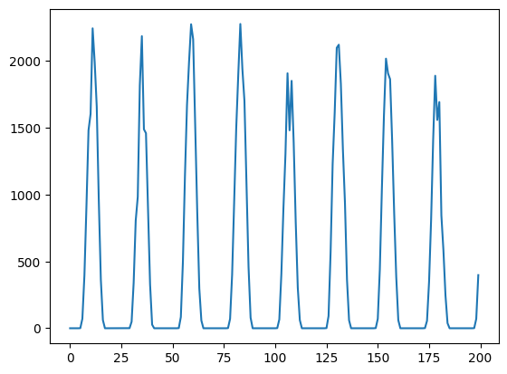
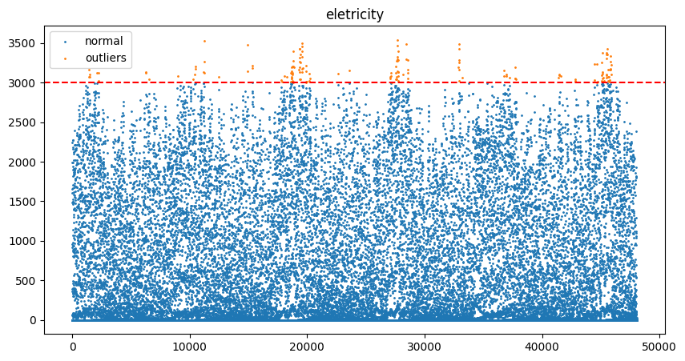
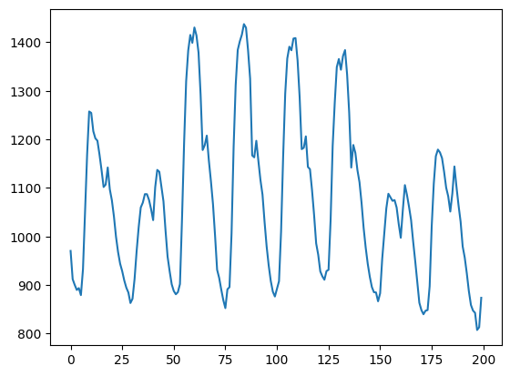
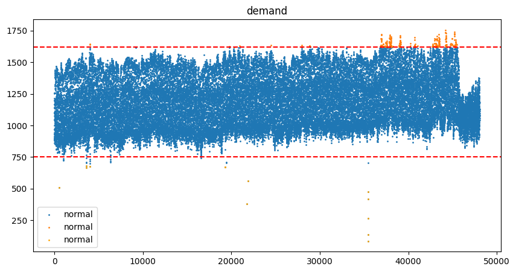

# This is a Informer time series prediction project for photovoltaic data.
## Use Model: Informer
## Simulation Data: Photovoltaic Dataset in Panama
NASA/POWER CERES/MERRA2 Native Resolution Hourly Data 
Dates (month/day/year): 10/01/2020 through 10/08/2023 
Location: Latitude  39.9055   Longitude 116.3914 
Elevation from MERRA-2: Average for 0.5 x 0.625 degree lat/lon region = 221.57 meters
The value for missing source data that cannot be computed or is outside of the sources availability range: -999 
Parameter(s): 
ALLSKY_SFC_SW_DWN      CERES SYN1deg All Sky Surface Shortwave Downward Irradiance (Wh/m^2) 全天空表面短波下向辐照度
ALLSKY_KT              CERES SYN1deg All Sky Insolation Clearness Index (dimensionless) 全天空日照清晰度指数
ALLSKY_SFC_PAR_TOT     CERES SYN1deg All Sky Surface PAR Total (W/m^2) 全天空表面光合有效辐射 (PAR) 总计

- All Sky Surface Shortwave Downward Irradiance：这是将太阳辐射能源传递到地面上的重要参数
- All Sky Insolation Clearness Index：这个指数是日照强度和大气透明度之间的关系，可以帮助量化大气遮挡的影响
- All Sky Surface photosynthetically ActiveRadiation (PAR) Total：这是指地表上接收到的光的能量范围，包括光谱中的可见光和近红外线

太阳数据下载地址：<https://power.larc.nasa.gov/data-access-viewer/>

假设有以下3个太阳辐射相关的变量：
a: All Sky Surface Shortwave Downward Irradiance (Wh/m^2)
b: All Sky Insolation Clearness Index (dimensionless)
c: All Sky Surface photosynthetically ActiveRadiation (PAR) Total (Wh/m^2)

则发电量可大致拟合为：
$$ (a, b, c) = k * a * b^0.5 * c^0.5 $$
## 数据集

 

## 发电量

 

 

## 用电量

 

 

